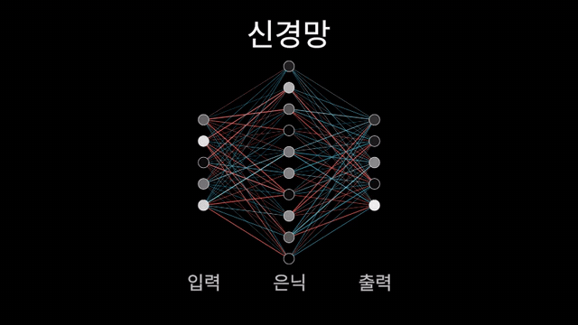
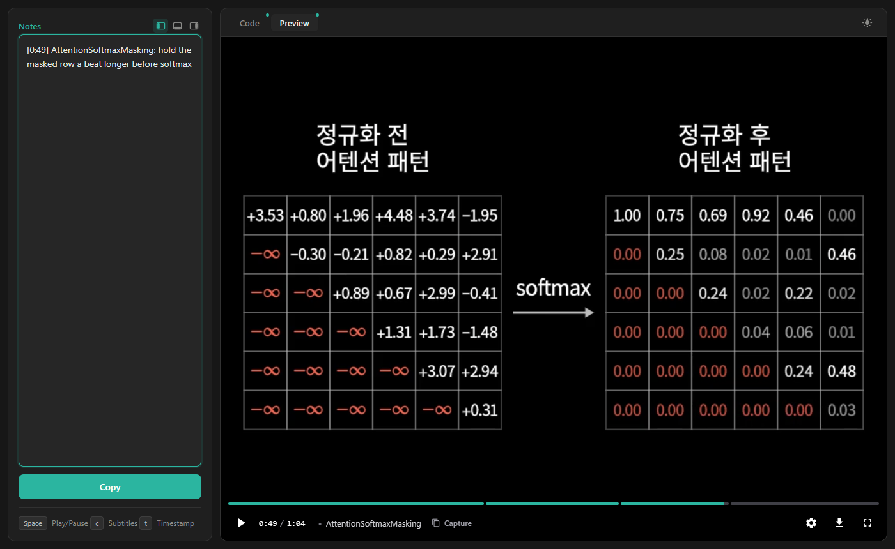

# manimgl-skill

**English** | [한국어](README-ko.md)

**Plan, render and revise 3Blue1Brown-style videos with Claude Code, on the CodingVillainKor/manimgl fork**

A Claude Code plugin for the [CodingVillainKor/manimgl](https://github.com/CodingVillainKor/manimgl) fork only: 3b1b/manim with defaults adjusted for a Korean environment. Its rules come from the fork source at commit `455a4201` (2026-10-11), the usage patterns in manimgl-imcommit and real renders, with evidence cited as `file:line`. It is not for PyPI `manimgl` or ManimCE (`manim`).



## Installation

```
/plugin marketplace add getCurrentThread/manimgl-skill
/plugin install manimgl-skill@manimgl-skill
```

- From a shell: `claude plugin marketplace add getCurrentThread/manimgl-skill`, then `claude plugin install manimgl-skill@manimgl-skill`.
- From a local clone: `git clone https://github.com/getCurrentThread/manimgl-skill.git`, then `/plugin marketplace add <path to the clone>`. A relative path such as `./manimgl-skill` is resolved against the folder Claude Code was started in and registered as a fixed directory, so it breaks if the clone is moved or deleted (`Marketplace file not found at ...\.claude-plugin\marketplace.json`). If that happens: `/plugin marketplace remove manimgl-skill`, then add it again.
- Plugin commands are namespaced, so the command is **`/manimgl-skill:scene`**.
- The marketplace and the plugin are both named `manimgl-skill`; `owner`/`author` in `.claude-plugin/*.json` are placeholders (`manimgl-skill maintainers`), to be replaced on publishing.

Videos live under `src/<video>/` in a uv project with the fork pinned to `455a4201` (set up once per project). `/manimgl-skill:scene` runs the setup script itself when the project has no fork. To prepare a project by hand:

```bash
bash path/to/manimgl-skill/scripts/setup.sh [PROJECT_DIR] [--with-raenimgl] [--smoke]
```

- Requires `uv`, `ffmpeg` and `git`. Also wanted: `ffprobe` (the viewer needs it), an OpenGL context, and the Noto Sans KR font (the fork's default `Text` font). LaTeX with `dvisvgm` and cm-super is optional and only needed for `Tex`, `TexText` and other LaTeX-based classes.
- PROJECT_DIR defaults to the current folder. Without a `pyproject.toml` there, a Python 3.10 uv project is created. The script adds the fork plus `trimesh` and `pywavefront` (the fork imports them but does not declare them), then checks that `manimlib` really is the fork. A fork already at another commit is left unchanged, with a warning. `--smoke` renders a test scene; `--with-raenimgl` also adds raenimgl.
- If the project already depends on PyPI `manimgl`, it prints the fix command and exits 2 without changing anything.
- Verified on Windows 11 (Git Bash) with MiKTeX only. Every branch, warning and MiKTeX note: [docs/details.md](docs/details.md#environment-setup-scriptssetupsh).

## How it works

In an empty folder, run `/manimgl-skill:scene <topic>`, for example `/manimgl-skill:scene 이진 탐색을 설명하는 30초 영상`.

1. **Plan** - Claude reads the source you point to (paper, docs, code). If the audience, length or depth is unclear, it asks at most 3 questions in one message. It then writes `src/<video>/scenes.md`: audience, core idea, hook, aha moment, misconception, color roles, and 1-8 scenes of 15-30 s each. No code is written until you approve the plan.
2. **Code & Render** - One class per scene in `src/<video>/main.py`. Each scene is checked on its last frame (`-sw`), then rendered as a 480p draft (`-w -l`) and read as 0.5 s frame sheets, because the last frame hides mid-animation overlaps. The read-only `scene-reviewer` agent can give a second look. The final render is `-w` (1920x1080, 30 fps) per scene.
3. **Iterate** - Claude joins the scenes into `full.mp4` and starts a local viewer (Python standard library and ffprobe) with one chapter per scene and a Code tab that shows `main.py`.

   

   Pause where something is wrong and press **t** or click **Capture**. The time and scene name go into **Notes** as `[M:SS] <Scene>: `; finish the line, for example `[0:07] Quantize: the label overlaps the axis`. Click **Copy** and paste the notes into Claude Code.

   For each line, Claude extracts that second of `full.mp4`, fixes only the named scene, re-renders it, rebuilds `full.mp4` and restarts the viewer on the same port. It compares the frames from before and after the fix, then reports back. Refresh the tab to watch the new version.

## Fork-verified rules

`skills/manimgl-best-practices` applies to any `from manimlib import *` code, inside or outside `/manimgl-skill:scene`. It covers ManimCE and upstream habits that fail or misbehave on the fork (`Create`, `MathTex`, `-ql`/`-p`, `Succession`, ...), constructor `color=` that many classes silently ignore, color names the fork lacks, module-level seeds that `Scene.__init__` overrides, Korean in `Text` and `Tex`, camera orbits, and the CLI.

- `references/`: 9 evidence documents with `F:`/`U:`/`R:`/`I:` `file:line` citations (fork, upstream, raenimgl, imcommit).
- `examples/`: 10 render-verified scene files. `gallery/`: 9 ported ML and math scene files (17 scenes), CC BY-NC-SA 4.0.
- The skill documents (`SKILL.md`, `references/`, templates) are written in English. Korean sample strings in them are intentional.

Full file map: [docs/details.md](docs/details.md#contents).

## Korean voiceover (opt-in)

Videos are silent unless you ask for narration (`Narration: voiceover` in scenes.md).

- `tools/tts.py` turns `narration.txt` into one clip per line plus `narration/timestamps.json`, cached by hash. The default engine is Windows SAPI with the local Korean voice Microsoft Heami Desktop.
- `--engine edge` uses edge-tts, which sends every line to Microsoft's online service. Claude uses it only if you choose it.
- `tools/voiceover.py` adds a `Narrated` mixin: `with self.voice(k):` plays line k, and each `-w` render gets an audio track and a per-scene `.srt` that the viewer joins into subtitles.
- No macOS or Linux engine is shipped. Details: [references/voiceover.md](skills/manimgl-workflow/references/voiceover.md).

## Lint hook and checks

While the plugin is enabled, a PostToolUse hook runs `scripts/lint_manimgl.py` after every Write/Edit/MultiEdit. It acts only on `.py` files that import manimlib or raenimgl (or `manim` inside a project whose pyproject names manimgl), never blocks, and hands its findings to Claude as context. It needs `python3` or `python` on PATH.

The same lint runs by hand, without the fork or a GPU: `python scripts/lint_manimgl.py <file>`. `scripts/check_docs.py`, `check_citations.py`, `check_inventory.py` and `check_examples.sh` test the docs' code, the API inventory and every example render against the fork, and the `file:line` citations against the pinned reference repos. Commands, requirements and exit codes: [docs/details.md](docs/details.md#checks).

## Where files go

Everything is written inside your uv project:

```
<uv project>/
  pyproject.toml           # fork pinned by setup.sh
  src/<video>/             # every command runs from here
    scenes.md              # the approved plan
    main.py                # one class per scene
    videos/<Scene>.png     # last frame (-sw)
    videos/<Scene>.mp4     # scene render (-w -l draft, then -w)
    concat.txt             # scene order for ffmpeg and the viewer
    full.mp4               # joined video
    narration.txt, narration/, voiceover.py, videos/<Scene>.srt, full.srt   # only with narration
```

manimgl writes its output under `videos/` of the current folder, which is why Claude works from `src/<video>`.

## License

There is no top-level LICENSE yet; one will be added once the copyright holder is decided. Until then, the third-party parts keep their own licenses:

| Part | Source | License |
|---|---|---|
| Viewer (`skills/manimgl-workflow/tools/video_viewer.py`, `ui.html`) and parts of `tts.py` (cache key, ffprobe durations, `timestamps.json`) | [Yusuke710/manim-skill](https://github.com/Yusuke710/manim-skill) | MIT, [tools/LICENSE-manim-skill](skills/manimgl-workflow/tools/LICENSE-manim-skill) |
| Planning references (`skills/manimgl-workflow/references/narrative-patterns.md`, `visual-techniques.md`, `templates/scenes-example.md`) | [adithya-s-k/manim_skill](https://github.com/adithya-s-k/manim_skill) `skills/manim-composer/` | MIT, [references/LICENSE-manim_skill](skills/manimgl-workflow/references/LICENSE-manim_skill) |
| `skills/manimgl-best-practices/gallery/` and renders of its scenes (`docs/demo.gif`, `docs/viewer.png`) | adithya-s-k/manim_skill, example code originally by Grant Sanderson / 3Blue1Brown | CC BY-NC-SA 4.0, [gallery/LICENSE.txt](skills/manimgl-best-practices/gallery/LICENSE.txt) |

**`gallery/` is NonCommercial and ShareAlike.** Whatever license the rest of the plugin gets will not cover it. A copy that includes `gallery/` or those two images cannot be used commercially, and modified gallery files must stay under CC BY-NC-SA 4.0.

The fork, 3b1b/manim, manimgl-imcommit, raenimgl and 3b1b/videos were read and compared; manimgl-imcommit and raenimgl have no LICENSE file, so no code was copied from them. Full table with pinned commits: [docs/details.md](docs/details.md#sources-and-licenses).
